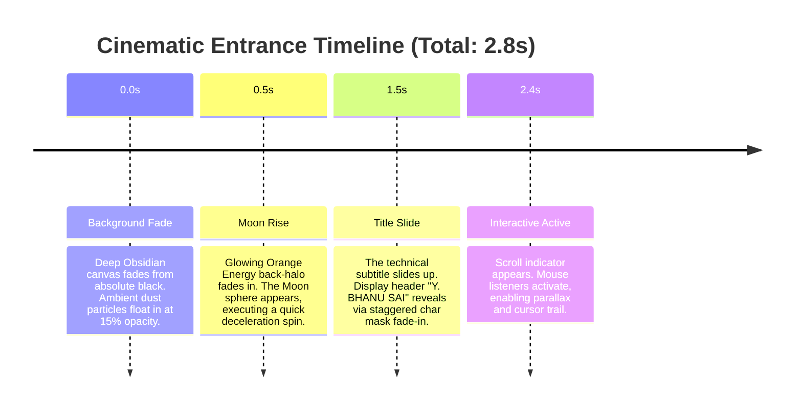
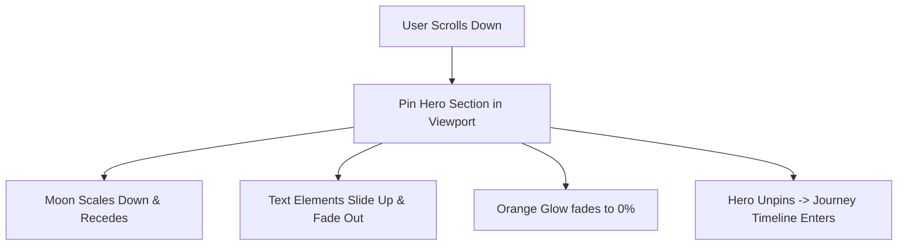

# Hero Section Architecture - Cinematic Launchpad

This document outlines the complete architectural design and animation specifications for the **Hero Section** of the portfolio. This section acts as the immersive opening sequence of the visual story, introducing **Y. Bhanu Sai** under a dark luxury atmosphere.

---

## 1. Component Breakdown

The Hero Section is designed to isolate the rendering concerns of its WebGL/Canvas graphics from the UI overlays to ensure maximum frame rates (60fps+).

```
Hero/
├── Hero.jsx            # Main container, layout coordinator, and ScrollTrigger triggers
├── MoonCanvas.jsx      # Canvas-based sphere mapper rendering the 3D rotating moon
├── HeroParticles.jsx   # 2D Canvas ambient dust and cursor-repelling particle generator
└── HeroContent.jsx     # Typography overlays (Syne + Inter), call-to-actions, scroll indicator
```

### `<Hero />` (Coordinator)
* **Responsibility**: Instantiates the layout, sets up the full-screen container (`100vh`), manages background styles, coordinates mouse-move parallax listeners, and binds the scroll-driven exit transition timeline via GSAP.

### `<MoonCanvas />` (Sphere Shading Canvas)
* **Responsibility**: Renders a realistic 3D Moon in the viewport.
* **Technique**: Employs a custom HTML5 2D Canvas sphere-mapping algorithm (or lightweight WebGL fragment shader) to wrap a grayscale moon texture map onto a simulated 3D sphere. By rendering lighting offsets and an orthographic projection loop, it animates a slow, majestic axial spin without requiring heavy 3D engines like Three.js.

### `<HeroParticles />` (Dynamic Physics Canvas)
* **Responsibility**: Renders a floating field of light-gray dust particles in a layered 3D space.
* **Technique**: Utilizes 2D Canvas rendering with coordinate projection. Particles float upward slowly and respond to the cursor (repelled when the cursor gets close, then drifting back to their flow vectors).

### `<HeroContent />` (UI Overlay)
* **Responsibility**: Renders the text elements using semantic HTML.
* **Structure**:
  * Tech Label: `"FRONTEND DEVELOPER // CREATIVE ENGINEER"` (Inter)
  * Display Title: `"Y. BHANU SAI"` (Syne, Extra Bold)
  * Brief Logline: `"Crafting premium, high-performance web experiences through cinematic motion and technical detail."` (Inter, Large Body)
  * Scroll Indicator: Subtle animated scroll arrow with an Orange Energy dot indicator.

---

## 2. Layer Structure (Z-Index Hierarchy)

To create a rich three-dimensional lighting depth (parallax and overlapping elements), elements are strictly ordered along the Z-axis:

| Layer Level | DOM Element | Z-Index | Purpose | CSS / Blend Rules |
| :--- | :--- | :--- | :--- | :--- |
| **L0: Base** | `div.hero-container` | `0` | Deep Obsidian base backdrop | `background: var(--color-bg-deep)` |
| **L1: Glows** | `<OrangeGlow />` | `1` | Soft ambient light behind the moon | `filter: blur(80px); opacity: 0.15` |
| **L2: 3D Object** | `<MoonCanvas />` | `2` | Centered spinning Moon | Position fixed/absolute |
| **L3: Particles** | `<HeroParticles />` | `3` | Floating dust field overlaying the moon | `pointer-events: none; mix-blend-mode: screen` |
| **L4: UI Overlay** | `div.hero-content` | `4` | Text, header, scroll indicators | `backdrop-filter: blur(0px); text-shadow: ...` |
| **L5: Global Nav** | `<Header />` | `100` | Global cinematic navigation | `position: fixed` |
| **L6: Cursor** | `<KatanaCursor />` | `9999` | Custom interactive energy trail | `position: fixed; pointer-events: none` |

---

## 3. Asset Requirements

To prevent layout shifts and slow load times, assets are preloaded:

1. **Moon Texture Map (`public/assets/moon_map.jpg`)**:
   * Grayscale spherical diffuse map of the Moon surface (recommended resolution: 1024x512 pixels to balance crispness with load time).
   * Wrapped dynamically onto the simulated sphere coordinates.
2. **Displacement/Normal Map (`public/assets/moon_bump.jpg`)** *(Optional for Canvas 2D, mandatory if WebGL is used)*:
   * Grayscale normal/bump map to add depth to crater lighting at the terminator line (where light transitions to shadow).
3. **Google Fonts**:
   * `Syne` (weights: 700, 800)
   * `Inter` (weights: 300, 400, 500)

---

## 4. Animation Sequence (Cinematic Staging)

Upon loading, the Hero Section executes a staggered timeline designed to feel like a movie intro:



### Timeline Specs (GSAP Sequence)
1. **Reset State**: Set `opacity: 0` for all text blocks, particles, and glows. Set the Moon scale to `0.85` of its target size.
2. **Staged Execution**:
   * **`0.0s`**: Fade in particle canvas opacity `0 -> 0.4` over `1.5s` (ease: `power2.out`).
   * **`0.5s`**: Scale up and fade in the Moon back-glow (`0.15` opacity, ease: `power3.out`). Spin the Moon texture coordinates rapidly to simulate a spin-down entrance, settling into a slow idle speed.
   * **`1.2s`**: Stagger-reveal title characters. Animate `y: 40 -> 0` and `skewY: 6 -> 0` with `opacity: 1` using ease `power4.out`.
   * **`2.2s`**: Fade in the technical subtitle and scroll indicator. Turn on mouse-move event handlers.

---

## 5. Mouse Parallax (3D Spatial Depth)

As the cursor travels across the viewport, layers shift in opposition to generate physical depth:

* **Mouse Parallax Formula**:
  `TargetX = (CursorX - WindowWidth / 2) * ParallaxFactor`
  `TargetY = (CursorY - WindowHeight / 2) * ParallaxFactor`
* **Parallax Multipliers**:
  * L1 (Ambient Glows): `ParallaxFactor = -0.01` (moves slightly in reverse)
  * L2 (Moon Canvas): `ParallaxFactor = 0.025` (moves slightly with the cursor)
  * L3 (Particles): `ParallaxFactor = 0.04` (foreground particles shift faster)
  * L4 (Typography): `ParallaxFactor = 0.015` (subtle shift to keep text readable)

To prevent stuttering, all parallax translations are computed inside a `requestAnimationFrame` loop using linear interpolation (lerp at `0.08` speed) instead of direct DOM positioning.

---

## 6. Scroll Behavior & Transitions

When scrolling down, the Hero Section initiates a smooth, scroll-linked exit animation utilizing **GSAP ScrollTrigger**:



### Transition Timing Parameters
* **Trigger Element**: `div.hero-container`
* **Pinning**: `pin: true` (keeps the canvas elements in the viewport while the timeline executes)
* **Scrub Rate**: `scrub: 1` (syncs animation progress exactly with the scroll momentum, easing over 1 second)
* **Start / End Boundaries**:
  * Start: `"top top"`
  * End: `"+=100%"` (animates over one full viewport height of scroll)

---

## 7. Performance Strategy (60fps Target)

To prevent canvas rendering from slowing down lower-end or mobile devices, we employ several performance optimization tactics:

1. **DPR Capping**:
   * Clamp the canvas drawing ratio to `Math.min(window.devicePixelRatio, 2)`. Drawing canvases at 3x or 4x resolution on ultra-high-density displays degrades fill-rate performance without visual gain.
2. **Offscreen Canvas Rendering**:
   * Perform sphere mapping projection calculations on an invisible, offscreen canvas. Once mapped, copy the pre-rendered texture slices onto the visible canvas using `ctx.drawImage` to eliminate double-rendering loops.
3. **No React State in Render Loops**:
   * All coordinates, parallax targets, and scroll progress values are stored in `useRef` handles. The React component never re-renders after mounting; the canvas `requestAnimationFrame` loop reads state directly from refs.
4. **Mobile Adaptations (Responsive Scaling)**:
   * On touch devices (tracked via `CursorContext`), disable particle repulsion math and simplify/disable mouse parallax.
   * If `prefers-reduced-motion` is active, disable all scroll pinning, Moon rotations, and float particles, rendering a static high-fidelity lunar scene to conserve battery and CPU resources.
