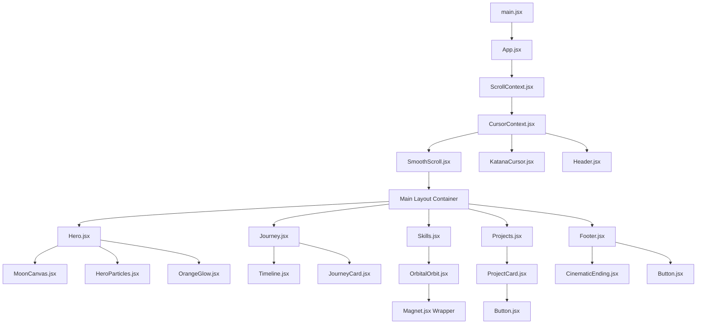
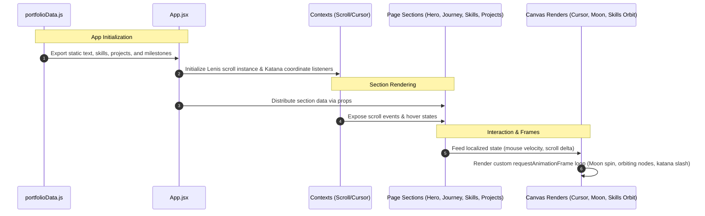

# Portfolio V2 - Production Architecture Design

This document details the production-level, scalable, and maintainable architecture for the cinematic storytelling portfolio website. It aligns with the design rules (**Dark Luxury** theme, **Orange Energy** accent, and **Katana Cursor**) and animation systems (**GSAP + ScrollTrigger + Lenis**) specified in the project documentation.

---

## 1. Folder & File Structure

A modular, component-centric architecture is employed to isolate concerns between core layout, full-screen storytelling sections, context providers, custom hooks, and Canvas/WebGL renders.

```
portfoliov2/
├── public/
│   └── assets/                     # Static media, 3D models, textures (e.g., Moon textures)
├── src/
│   ├── assets/                     # SVGs, raw static graphics, icons
│   ├── components/                 # Reusable UI elements & global components
│   │   ├── common/
│   │   │   ├── Header.jsx          # Cinematic minimal navigation
│   │   │   ├── KatanaCursor.jsx    # Custom canvas-based cursor trail
│   │   │   └── SmoothScroll.jsx    # Lenis wrapper component
│   │   └── ui/
│   │       ├── Button.jsx          # Orange Energy themed interactive buttons
│   │       ├── Magnet.jsx          # GSAP-powered magnetic hover wrapper
│   │       └── OrangeGlow.jsx      # Reusable ambient glowing gradient elements
│   ├── constants/
│   │   └── portfolioData.js        # Hardcoded content data (from CONTENT.md)
│   ├── context/
│   │   ├── CursorContext.jsx       # Custom cursor hover/state management
│   │   └── ScrollContext.jsx       # Coordinates GSAP ScrollTrigger & Lenis states
│   ├── hooks/
│   │   ├── useCanvas.js            # Custom hook for rendering animation loops on canvas
│   │   ├── useGSAP.js              # Wrapper for component-level GSAP animation registers
│   │   └── useWindowSize.js        # Responsive design tracking for orbit and canvas math
│   ├── sections/                   # Core storytelling full-screen sections
│   │   ├── Hero/
│   │   │   ├── Hero.jsx            # Main Hero controller
│   │   │   ├── MoonCanvas.jsx      # WebGL/Canvas rotating moon renderer
│   │   │   └── HeroParticles.jsx   # Ambient particle generator
│   │   ├── Journey/
│   │   │   ├── Journey.jsx         # Main Journey controller
│   │   │   ├── Timeline.jsx        # SVG/CSS dynamic scroll timeline
│   │   │   └── JourneyCard.jsx     # Career milestone details card
│   │   ├── Skills/
│   │   │   ├── Skills.jsx          # Main Skills controller
│   │   │   └── OrbitalOrbit.jsx    # Orbiting skill nodes container
│   │   ├── Projects/
│   │   │   ├── Projects.jsx        # Main Projects controller
│   │   │   └── ProjectCard.jsx     # Individual project slide
│   │   └── Footer/
│   │       ├── Footer.jsx          # Main Footer controller
│   │       └── CinematicEnding.jsx # WebGL/Canvas cinematic closing scene
│   ├── styles/
│   │   ├── index.css               # Global CSS variables, Dark Luxury theme, utilities
│   │   └── lenis.css               # Lenis scroll configuration overrides
│   ├── utils/
│   │   ├── gsapRegistry.js         # Unified GSAP + ScrollTrigger registration
│   │   └── math.js                 # Coordinate mathematics (Orbital calculations, circles)
│   ├── App.jsx                     # Root application coordinator
│   └── main.jsx                    # Vite entry point
```

---

## 2. File Directory & Purpose

| File / Directory | Layer | Purpose |
| :--- | :--- | :--- |
| `App.jsx` | Coordinator | Manages global layout, renders core sections sequentially, and initializes contexts. |
| `src/constants/portfolioData.js` | Data | Holds static copy, skill listings, projects, and career timeline milestones. Keeps text out of markup. |
| `src/context/CursorContext.jsx` | State | Tracks mouse positions, cursor hover states (e.g., hovering links), and broadcasts target state to `KatanaCursor`. |
| `src/context/ScrollContext.jsx` | State | Exposes the Lenis instance globally so other components can bind ScrollTrigger instances or check scroll positions. |
| `src/components/common/KatanaCursor.jsx`| Global UI | Listens to cursor coordinates; draws a dynamic katana-blade-like swipe trail using canvas rendering. |
| `src/components/common/SmoothScroll.jsx`| Global UI | Initializes Lenis smooth scrolling and updates GSAP ScrollTrigger on every tick. |
| `src/sections/Hero/MoonCanvas.jsx` | WebGL/Canvas | Uses canvas (or WebGL) to render and rotate a high-definition moon sphere. |
| `src/sections/Journey/Timeline.jsx` | Animation UI | Draws the timeline line using SVG paths that animate their `stroke-dashoffset` as the user scrolls. |
| `src/sections/Skills/OrbitalOrbit.jsx` | Math/UI | Computes orbital coordinates using `utils/math.js` to arrange and rotate skill nodes. |
| `src/utils/gsapRegistry.js` | Utility | Handles global registration of GSAP plugins (ScrollTrigger, CSSPlugin) once, preventing multi-bundle import bugs. |
| `src/styles/index.css` | Styling | Houses the global variables (`--background` dark luxury Obsidian blacks, `--accent` Orange Energy `#FF5F1F`), custom typography, and resetting styles. |

---

## 3. Component Hierarchy

The tree layout below demonstrates how components nest. Note the centralized context wrappers controlling global scroll animations and mouse-tracking behaviors.



---

## 4. Data Flow



1. **Static Content Flow**: Content is defined in `portfolioData.js` and imported at the section level or by `App.jsx` to be passed as props. This decouples logic from presentation.
2. **Scroll Context Flow**: `SmoothScroll.jsx` instantiates Lenis. It emits scroll positions, binding GSAP's `ScrollTrigger.update` directly. Any section component listening to scroll updates hooks into the global `ScrollContext`.
3. **Cursor State Flow**: Custom interactive triggers (like buttons or project cards) toggle states (e.g. `setHoverState('project-hover')`) inside `CursorContext`. The global `KatanaCursor` listens to these states to dynamically adjust its slash trail thickness, speed, color, or glow.

---

## 5. Animation Ownership

To keep performance at **60fps (or higher)** on all devices, animations are strictly partitioned by their resource profile:

```
┌──────────────────────────────────────────────────────────────────┐
│                      ANIMATION ARCHITECTURE                      │
├───────────────────────┬───────────────────┬──────────────────────┤
│    ANIMATION TYPE     │ ENGINE / LIBRARY  │    OWNING FILE       │
├───────────────────────┼───────────────────┼──────────────────────┤
│ Smooth Scroll         │ Lenis             │ SmoothScroll.jsx     │
│ Timeline Reveals      │ GSAP ScrollTrigger│ Journey/Timeline.jsx │
│ Project Stack Reveals │ GSAP ScrollTrigger│ Projects/Projects.jsx│
│ Katana Cursor Trail   │ HTML5 Canvas 2D   │ KatanaCursor.jsx     │
│ Orbit Node Rendering  │ HTML5 Canvas / CSS│ OrbitalOrbit.jsx     │
│ Moon Rotation         │ WebGL / Canvas    │ MoonCanvas.jsx       │
│ Hero Dust Particles   │ Canvas 2D         │ HeroParticles.jsx    │
│ Hover Attraction      │ GSAP Core (Tween) │ common/ui/Magnet.jsx │
└───────────────────────┴───────────────────┴──────────────────────┘
```

### Animation Guidelines for Production

1. **GSAP for Structural Layout Timelines**:
   * GSAP handles DOM-level animations: fading in elements, pinning full-screen sections (Projects, Journey), and synchronizing timeline progress with ScrollTrigger.
   * **Rule**: Use GSAP's `useGSAP` or cleanup hooks to kill active ScrollTrigger animations on component unmount to prevent memory leaks.
2. **Canvas/WebGL for Dense Graphic Scenes**:
   * Particles, the rotating moon, orbital node trails, and the custom cursor trail are drawn using canvas `2D` or WebGL render loops (`requestAnimationFrame`). 
   * **Rule**: Never use heavy React state updates inside canvas animation loops. Pass raw variables or use ref handles (`useRef`) to update values inside the rendering loop to avoid DOM re-renders.
3. **CSS Transitions for Basic Hovers**:
   * Simple link colors, button text offsets, and luxury ambient orange glow expansions are handled via vanilla CSS transitions (`transition: all 0.3s cubic-bezier(0.25, 1, 0.5, 1)`) to offload rendering to the browser's compositor thread.
